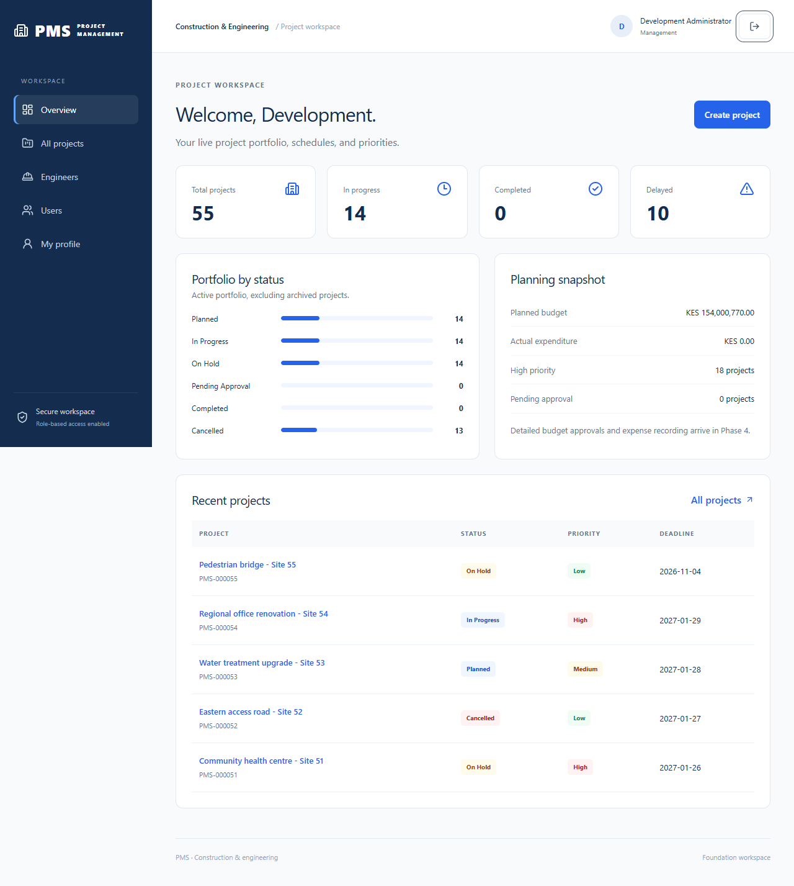

# Project Management System

A full-stack project planning and management application for construction and engineering organizations, built with **Java 21, Spring Boot, React, TypeScript, and PostgreSQL**.

**Current release scope:** authentication, user administration, project planning, assignments, tasks, resource tracking, independent approvals, evidence, notifications, and report exports. The app supports the complete local project execution flow.

[Setup guide](project-management-system/README.md#getting-started) | [API reference](project-management-system/docs/API.md) | [Architecture](project-management-system/docs/ARCHITECTURE.md) | [Roadmap](project-management-system/docs/IMPLEMENTATION_STATUS.md)



*Dashboard shown with the optional 55-project PostgreSQL development seed.*

## Features

- Session-cookie authentication, CSRF protection, BCrypt passwords, and backend role checks.
- Super-administrator user management, suspension/reactivation, and administrative audit records.
- Searchable engineer directory and department management.
- Project creation, editing, archival, filtering, sorting, and pagination.
- Unique project codes, validated managers, priorities, dates, and preserved schedule history.
- Live portfolio totals and status distribution calculated from PostgreSQL.
- Exact decimal planned budgets and concurrency checks for shared records.
- Responsive React workspace with lazy-loaded feature pages.
- Engineer assignments, task transfers, and weighted approved progress.
- Labor/material tracking, budget revisions, expenses, and evidence-based completion.
- In-app overdue notifications, approved extensions, PDF/Excel/CSV reports, and single-JAR packaging.

## Getting started

Clone the repository and open the application directory:

```powershell
git clone https://github.com/omarlibaax/Project-Management-System.git
Set-Location .\Project-Management-System\project-management-system
```

Follow the **[application setup guide](project-management-system/README.md#getting-started)** to configure PostgreSQL, set environment variables, and start both services.

The application runs locally at **http://127.0.0.1:5173**. Development account passwords are supplied through environment variables; no default password is included.

## Technology

| Backend | Frontend | Database and verification |
| --- | --- | --- |
| Java 21, Spring Boot 4.1.2 | React 19.3.1, TypeScript, Vite | PostgreSQL 18, Flyway |
| Spring Security, Spring Data JPA | Tailwind, React Query, Zod | JUnit 5, Vitest, Playwright |
| Maven wrapper | React Hook Form, Axios | PostgreSQL-backed integration tests |

## Project status

| Phase | Scope | Status |
| --- | --- | --- |
| 1 | Foundation and authentication | Complete |
| 2 | Users, projects, schedules, portfolio summaries | Complete |
| 3 | Assignments and task management | Implemented |
| 4 | Resources and finance | Implemented |
| 5 | Evidence and approvals | Implemented |
| 6 | Scheduling automation and reporting | Implemented |
| 7 | Local verification and deployment preparation | Implemented; external hosting remains |

Engineers see only actively assigned projects. Requests require a different manager to review them; create at least two management accounts. Follow the [execution walkthrough](project-management-system/docs/EXECUTION.md) and [deployment guide](project-management-system/docs/DEPLOYMENT.md).

Backend verification on **8 November 2026** passed **39 PostgreSQL-backed tests**; frontend verification passed **16 tests**. All five packaged browser workflows passed. See the [requirements review](project-management-system/docs/REQUIREMENTS_REVIEW.md) and [verification guide](project-management-system/docs/TESTING.md).

## Documentation

The application source is in [project-management-system/](project-management-system/).

- [Full README and installation](project-management-system/README.md)
- [API contracts](project-management-system/docs/API.md)
- [Architecture and permissions](project-management-system/docs/ARCHITECTURE.md)
- [Phase 2 walkthrough](project-management-system/docs/PHASE_2.md)
- [Implementation status](project-management-system/docs/IMPLEMENTATION_STATUS.md)
- [Testing guide](project-management-system/docs/TESTING.md)
