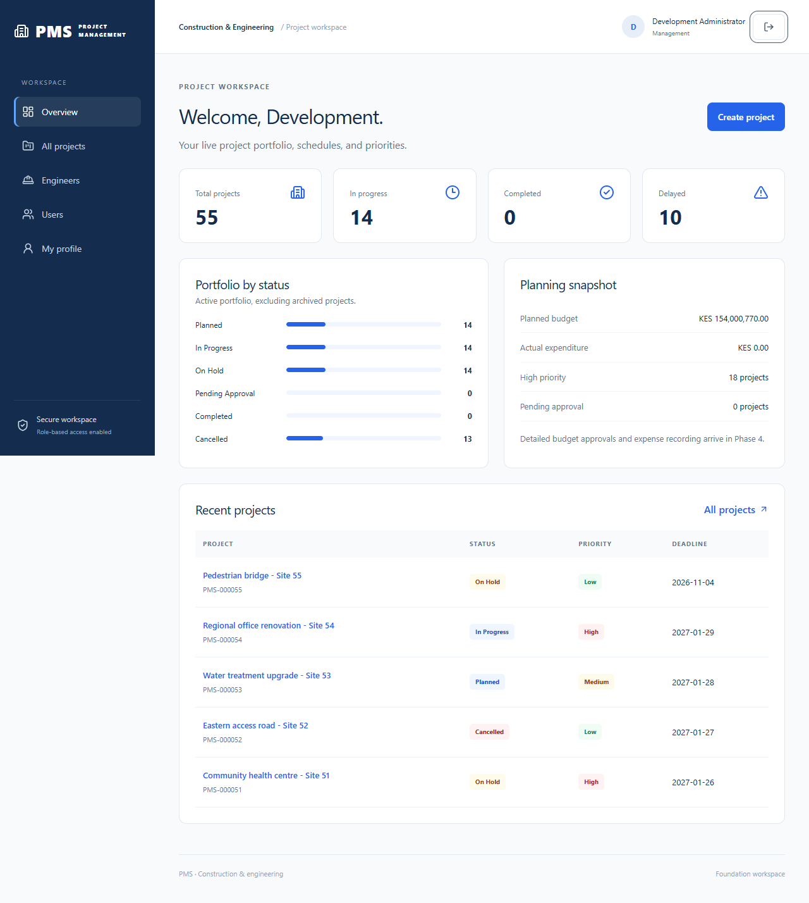

# Project Management System

A full-stack workspace for construction and engineering organizations to manage project plans, teams, schedules, and portfolio visibility.

**Development status:** Phases 1 and 2 are complete. Assignments, task management, resource tracking, approval workflows, and reporting are planned for subsequent phases.

[Getting started](#getting-started) | [Features](#implemented-features) | [Configuration](#configuration) | [Testing](#testing) | [Roadmap](#roadmap) | [Documentation](#documentation)



*Dashboard populated by the optional 55-project PostgreSQL development seed. Statistics are calculated by the backend.*

## Implemented features

### Identity and access

- Session-based authentication with HttpOnly cookies and CSRF protection.
- BCrypt password hashing, password changes, and account lockout after repeated failed logins.
- Server-enforced roles: `SUPER_ADMIN`, `ADMIN`, and `ENGINEER`.
- User creation, profile administration, role assignment, suspension, and reactivation.
- Department management and a searchable, paginated engineer directory.
- Audit records for authentication and administrative changes.

### Project planning

- Create, view, edit, search, filter, and archive projects.
- Automatically generated unique project codes.
- Active project-manager validation, priorities, and controlled status changes.
- Planned schedules, inclusive duration, and actual start dates.
- Original schedule preservation and a history of authorized date changes.
- Timezone-aware overdue indicators, separate from project status.
- Optimistic concurrency checks that prevent silent overwrites.
- Exact decimal planned budgets using Java `BigDecimal` and PostgreSQL `NUMERIC`.

### Workspace and dashboard

- Database-backed portfolio totals and project status distribution.
- Planned-budget and actual-expenditure summaries.
- Responsive navigation, reusable forms, accessible labels, and loading/error states.
- Lazy-loaded React feature pages.
- Optional, repeatable development seeding for 55 projects.

Actual expenses and task progress will be recorded by their respective modules in later phases. Completion and pending-approval states cannot be set through ordinary project forms.

## Roles and permissions

| Capability | Super administrator | Administrator / manager | Engineer |
| --- | --- | --- | --- |
| Manage users and roles | Yes | No | No |
| Create departments | Yes | No | No |
| View engineer directory | Yes | Yes | No |
| Create, edit, and archive projects | Yes | Yes | No |
| View portfolio dashboard | Yes | Yes | No |
| Sign in and change own password | Yes | Yes | Yes |

Engineer assignment management is scheduled for Phase 3. Until assignments exist, engineers receive an empty project list and cannot retrieve project details. Authorization is enforced by the backend.

## Technology stack

| Layer | Technologies |
| --- | --- |
| Backend | Java 21, Spring Boot 4.1.2, Spring MVC, Spring Security |
| Persistence | Spring Data JPA, Hibernate, PostgreSQL 18, Flyway |
| Frontend | React 19.3.1, TypeScript 7.0.2, Vite 8.3.6 |
| UI | Tailwind CSS, Radix/CVA controls, Lucide icons |
| Forms and data | React Hook Form, Zod, TanStack Query, Axios |
| Testing | JUnit 5, Spring integration tests, Vitest, Testing Library, Playwright |
| Build tools | Maven wrapper, npm |

The backend is a modular monolith with REST APIs. Vite proxies frontend API requests to Spring Boot during development. Flyway manages schema changes; Hibernate validates the schema.

See [selected dependency versions](docs/VERSIONS.md) and [architecture](docs/ARCHITECTURE.md) for details.

## Repository structure

The application lives inside the `project-management-system/` directory of the GitHub repository.

```text
project-management-system/
  backend/       Spring Boot application, security, services, migrations, tests
  frontend/      React application, feature pages, components, browser tests
  database/      PostgreSQL role and database setup
  docs/          Architecture, API contracts, implementation status, testing guides
  scripts/       Local verification helpers
  .env.example   Environment variable reference
  README.md      Application setup and development guide
```

## Getting started

These instructions use PowerShell on Windows. Run application commands from `project-management-system/` unless a step changes directories.

### 1. Prerequisites

Install Java 21, PostgreSQL 18, Git, and Node.js with npm. This project was verified with Node.js 26.13.0 and npm 11.20.0. Maven is downloaded automatically by the included wrapper.

```powershell
java -version
node --version
npm.cmd --version
git --version
```

Use `npm.cmd` in PowerShell to avoid execution-policy restrictions on `npm.ps1`. The first dependency installation requires internet access.

### 2. Clone the repository

```powershell
git clone https://github.com/omarlibaax/Project-Management-System.git
Set-Location .\Project-Management-System\project-management-system
```

### 3. Create the database

Start your PostgreSQL service, then run the setup script as a PostgreSQL administrator:

```powershell
$postgresBin = 'C:\Program Files\PostgreSQL\18\bin'
& "$postgresBin\psql.exe" -U postgres -f .\database\setup.psql
```

Adjust the installation path if necessary. The script creates the `pms_app` login and `project_management_db` database and prompts for a database password. Run it once against a fresh setup; use an existing configured database if one is already available.

### 4. Configure and start the backend

In the same terminal:

```powershell
$env:SPRING_PROFILES_ACTIVE = 'dev'
$env:PMS_DB_URL = 'jdbc:postgresql://localhost:5432/project_management_db'
$env:PMS_DB_USERNAME = 'pms_app'

$dbSecret = Read-Host 'Database password' -AsSecureString
$env:PMS_DB_PASSWORD = [System.Net.NetworkCredential]::new('', $dbSecret).Password

$env:PMS_SEED_ADMIN_EMAIL = 'admin@example.test'
$adminSecret = Read-Host 'Initial admin password (12-64 characters)' -AsSecureString
$env:PMS_SEED_ADMIN_PASSWORD = [System.Net.NetworkCredential]::new('', $adminSecret).Password

$env:PMS_SEED_ENGINEER_EMAIL = 'engineer@example.test'
$engineerSecret = Read-Host 'Initial engineer password (12-64 characters)' -AsSecureString
$env:PMS_SEED_ENGINEER_PASSWORD = [System.Net.NetworkCredential]::new('', $engineerSecret).Password

Set-Location backend
.\mvnw.cmd spring-boot:run
```

Flyway applies pending migrations at startup. Development accounts are created only when their email is absent. **There is no default password.** Restarting does not reset a password you have changed.

### 5. Start the frontend

Open a second PowerShell terminal in `project-management-system/`:

```powershell
Set-Location frontend
npm.cmd ci
npm.cmd run dev
```

| Service | Local address |
| --- | --- |
| Application | http://127.0.0.1:5173 |
| Backend | http://127.0.0.1:8080 |
| Health check | http://127.0.0.1:8080/actuator/health |

Sign in using the email and password configured above. Keep the browser hostname consistent throughout your session. Stop foreground servers with `Ctrl+C`.

### Optional: sample project portfolio

Before starting the backend, enable:

```powershell
$env:PMS_SEED_PROJECTS = 'true'
```

With the `dev` profile and a configured development administrator, this creates 55 sample projects only when the project table is empty. Seeding is disabled by default and preserves existing project records. It does not create task assignments, expenses, or approval evidence.

## Configuration

[.env.example](.env.example) lists the supported variables. It is a reference file: Spring Boot does **not** load it automatically. Set values in the backend terminal or your run configuration.

| Variable | Purpose | Default / requirement |
| --- | --- | --- |
| `SPRING_PROFILES_ACTIVE` | Spring profile | Set `dev` for local development |
| `PMS_DB_URL` | PostgreSQL JDBC URL | `jdbc:postgresql://localhost:5432/project_management_db` |
| `PMS_DB_USERNAME` | Database login | `pms_app` |
| `PMS_DB_PASSWORD` | Database password | Required |
| `PMS_SEED_ADMIN_EMAIL` | Initial super-administrator email | Explicitly configure for dev seeding |
| `PMS_SEED_ADMIN_PASSWORD` | Initial super-administrator password | Explicitly configure for dev seeding |
| `PMS_SEED_ENGINEER_EMAIL` | Initial engineer email | Explicitly configure for dev seeding |
| `PMS_SEED_ENGINEER_PASSWORD` | Initial engineer password | Explicitly configure for dev seeding |
| `PMS_SEED_PROJECTS` | Seed an empty project table | `false`; dev profile only |
| `PMS_TIMEZONE` | Organization business timezone | `Africa/Nairobi` |
| `PMS_CURRENCY` | Company currency label | `KES` |
| `PMS_SECURE_COOKIE` | Require HTTPS for session cookies | `true`; dev profile defaults to `false` |
| `SERVER_PORT` | Backend HTTP port | `8080` |
| `PMS_API_TARGET` | Vite development proxy target | `http://127.0.0.1:8080` |

If you change `SERVER_PORT`, set `PMS_API_TARGET` in the frontend terminal to match.

## Testing

The last recorded verification on **7 November 2026** completed successfully:

| Check | Recorded result |
| --- | --- |
| PostgreSQL-backed backend tests | 24 passed |
| Frontend tests | 12 passed |
| Real-browser workflows | 4 passed |
| Backend and frontend production builds | Passed |

Coverage includes authentication, roles, suspension, project validation, schedule history, archival, exact monetary values, and 55-project pagination and aggregation.

**Use a separate disposable PostgreSQL database for integration tests.** Configure its URL and credentials in a dedicated terminal before running:

```powershell
# From backend/, with test database environment variables configured:
$env:SPRING_PROFILES_ACTIVE = 'test'
.\mvnw.cmd -B -ntp test package
```

```powershell
# From frontend/:
npm.cmd test
npm.cmd run build
```

[TESTING.md](docs/TESTING.md) provides the isolated database setup and browser verification procedure. The Windows browser helper uses Microsoft Edge, a built backend JAR, and the documented local test cluster on port `55432`.

## Roadmap

| Phase | Scope | Status |
| --- | --- | --- |
| 1 | Foundation, authentication, authorization, application layout | Complete |
| 2 | Users, engineer directory, projects, planning schedules, portfolio summaries | Complete |
| 3 | Engineer assignments, transfers, tasks, weighted progress | Planned |
| 4 | Labor, materials, budgets, expenses, resource variances | Planned |
| 5 | Progress evidence, secure uploads, approvals, completion workflows | Planned |
| 6 | Scheduled delay detection, notifications, schedule approvals, PDF/Excel reports | Planned |
| 7 | Full workflow verification, performance review, deployment preparation | Planned |

See [implementation status](docs/IMPLEMENTATION_STATUS.md) for current boundaries and remaining work.

## Troubleshooting

| Symptom | What to check |
| --- | --- |
| Invalid credentials or account unavailable | Verify the account email, current password, activation, and lockout status. Seed passwords do not overwrite existing accounts. |
| Workspace unavailable | Confirm PostgreSQL and the backend are running; inspect backend startup output. |
| Missing database password | Set `PMS_DB_PASSWORD` in the terminal that starts Spring Boot. |
| Port already in use | Stop the earlier project process or configure another port and matching frontend proxy target. |
| Maven cannot replace the application JAR | Stop the backend before packaging; Windows locks a running JAR. |
| HTTP 409 while saving | Reload the latest record before editing; another operation may have changed its version. |
| Engineer project list is empty | Assignment management is planned for Phase 3; unassigned project access is restricted. |

## Security and deployment

Authentication is handled by Spring Security. Browser authentication tokens are not stored in localStorage. Protected mutations require CSRF tokens, and administrative permissions are checked on the server.

For deployment, use a single HTTPS origin, keep Secure cookies enabled, provide credentials through environment variables or a secret manager, and disable development profiles and seeds. Sessions are currently held in memory, so backend restarts require users to sign in again.

Production deployment and the remaining business workflows are part of the roadmap. Review the [architecture notes](docs/ARCHITECTURE.md) before preparing an environment.

## Documentation

| Guide | Contents |
| --- | --- |
| [Architecture](docs/ARCHITECTURE.md) | Module structure, security model, permission matrix, ER diagrams |
| [API reference](docs/API.md) | Endpoints, DTO fields, filters, status codes |
| [Phase 2 guide](docs/PHASE_2.md) | Implementation walkthrough, KPI definitions, manual tests |
| [Implementation status](docs/IMPLEMENTATION_STATUS.md) | Completed features and remaining phases |
| [Testing](docs/TESTING.md) | Recorded results and reproducible verification |
| [Dependency versions](docs/VERSIONS.md) | Selected backend and frontend versions |
| [Source inventory](docs/FILES.md) | Repository files and module locations |