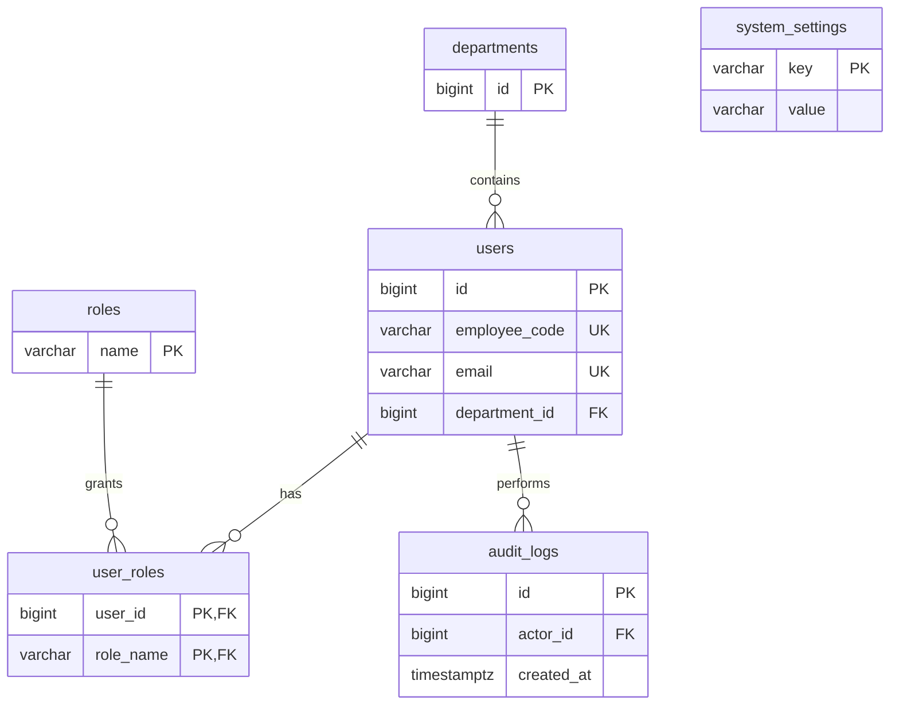
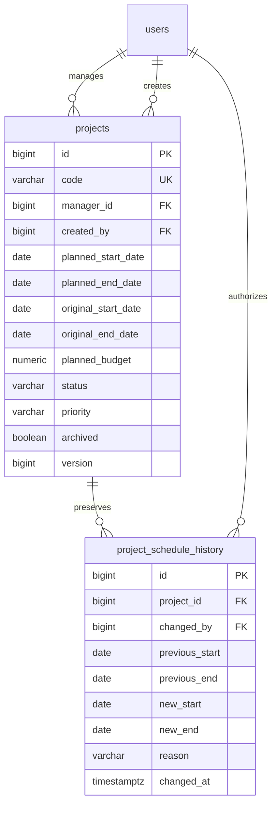

# Architecture and mentoring notes
This is a single-organization modular monolith. React talks to Spring MVC through /api.
In development Vite proxies /api and /actuator to Spring on port 8080. The browser sees
one origin, so no permissive cross-origin configuration is needed.

Spring Security handles form login, session fixation protection, CSRF and logout.
The session cookie is HttpOnly, SameSite=Lax, and Secure by default; only the dev
profile permits plain HTTP. CSRF tokens are held in browser memory, never localStorage.
GET /api/auth/csrf materializes the token and returns its header name. Fetch a fresh
token before each mutation, particularly after login (which rotates the CSRF token).

AppUser maps identity tables; UserRepository reads accounts. AccountDetailsService
adapts accounts to Spring Security. LoginAttemptService handles lockout and audit
transactions. AccountService owns password changes. Controllers return explicit DTOs.
ActiveAccountFilter rechecks activation and role changes on every authenticated request.

Flyway owns schema changes. Hibernate validates, never creates or updates tables.
V1 introduces only foundation tables. Each subsequent business module gets its own migration.
No financial or project statistics appear until their real database-backed modules exist.

## Identity ERD

## Permissions in Phase 1
| Route | Anonymous | Engineer | Admin | Super admin |
| --- | --- | --- | --- | --- |
| Health, CSRF, login | Yes | Yes | Yes | Yes |
| Profile, workspace, password, logout | No | Own | Own | Own |
| Admin access check | No | No | Yes | Yes |

Future project access must query active assignments on the backend, including downloads
and reports. A frontend role check is for presentation only.
Storage adapters, uploads, reporting and advanced business workflows belong to
later phases and have not been represented as completed foundation features.

## Production
Serve frontend assets and /api behind one HTTPS origin. Forward only trusted proxy headers.
Keep Secure cookies enabled. Set DB credentials in a secret manager/environment.
Run without the dev profile and without seed variables. No public registration exists.
Back up PostgreSQL and test restores. Restrict database access and actuator exposure.
The current in-memory servlet sessions require sign-in again after a backend restart.
Use a separately provisioned migration identity and restrict runtime DB privileges before deployment.
## Phase 2 modules
ProjectService enforces server permissions, original schedule preservation, status rules,
decimal planning amounts and optimistic concurrency. UserService controls super-admin
user lifecycle. DashboardService uses one PostgreSQL aggregate query for portfolio KPIs.
Project monetary DTO fields serialize as strings, preserving cents beyond JavaScript's
safe integer range. React uses BigInt for currency grouping instead of rounding values.

| Capability | Engineer | Admin | Super admin |
| --- | --- | --- | --- |
| User creation/edit/status | No | No | Yes |
| Engineer directory / managers / departments read | No | Yes | Yes |
| Department creation | No | No | Yes |
| Project creation/edit/archive | No | Yes | Yes |
| Project list/detail | Empty list / 404 detail until assignments | All | All |
| Manager dashboard | No | Yes | Yes |

Phase 3 must replace the current no-assignment engineer scope with active assignment
checks consistently across lists, details, downloads, reports, mutations and dashboards.

### Project ERD

